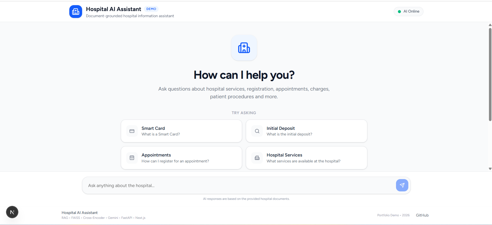
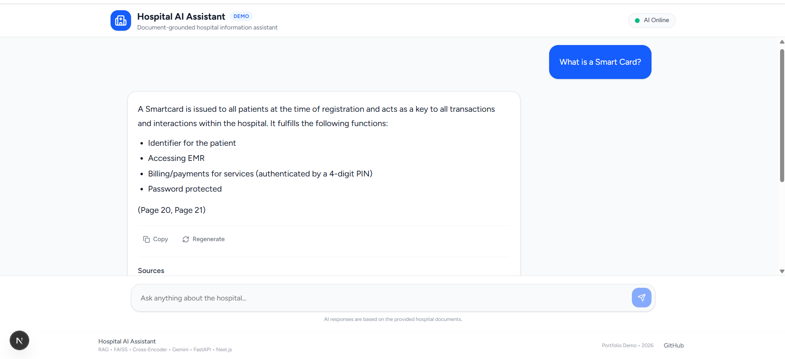
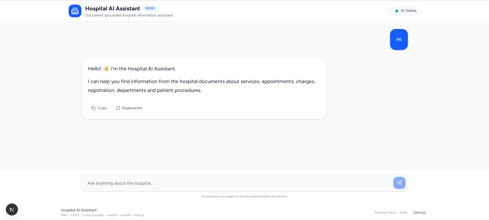

# 🏥 Hospital AI Assistant

A full-stack Retrieval-Augmented Generation (RAG) application that answers questions from hospital documents using semantic search, Cross-Encoder reranking, and Google Gemini.

## ✨ Features

- Document-grounded question answering
- FAISS-based semantic retrieval
- Cross-Encoder reranking
- Google Gemini for answer generation
- Query classification for generic and out-of-scope questions
- Minimal and relevant source citations
- Markdown-formatted responses
- Animated loading state
- Auto-scrolling chat interface
- Clean responsive Next.js UI

## 🧠 Architecture

```text
User Question
      ↓
Query Classification
      ↓
FAISS Semantic Retrieval
      ↓
Top 15 Candidates
      ↓
Cross-Encoder Reranking
      ↓
Top 3 Relevant Documents
      ↓
Context Building
      ↓
Google Gemini
      ↓
Grounded Answer + Sources
````

## 📚 Knowledge Base

Currently uses:

* `TMH_Patient_Booklet_2026.pdf`

## 🤖 Models

**Embeddings**

* `BAAI/bge-small-en-v1.5`

**Reranker**

* `cross-encoder/ms-marco-MiniLM-L-6-v2`

**LLM**

* Google Gemini

## 🛠️ Tech Stack

### Backend

* Python
* FastAPI
* FAISS
* LangChain
* Sentence Transformers
* Cross-Encoder
* PyMuPDF

### Frontend

* Next.js
* React
* TypeScript
* Tailwind CSS
* React Markdown
* Lucide React

## 📁 Project Structure

```text
Hospital-RAG/
├── backend/
│   └── app/
│       ├── api/
│       ├── models/
│       └── rag/
├── data/
│   └── vectorstore/
│       └── faiss_index/
├── frontend/
├── requirements.txt
├── .gitignore
└── README.md
```

## 🚀 Run Locally

### Backend

```bash
python -m venv .venv
```

Windows:

```powershell
.\.venv\Scripts\Activate.ps1
```

Install dependencies:

```bash
pip install -r requirements.txt
```

Configure your Gemini API key in `.env`:

```env
GEMINI_API_KEY=your_api_key
```

Start the backend:

```bash
cd backend
uvicorn app.main:app --reload
```

Backend:

```text
http://127.0.0.1:8000
```

Swagger:

```text
http://127.0.0.1:8000/docs
```

### Frontend

```bash
cd frontend
npm install
npm run dev
```

Frontend:

```text
http://localhost:3000
```

## 🎯 RAG Design Goals

The system focuses on:

* Improving retrieval relevance through reranking
* Keeping answers grounded in the hospital knowledge base
* Avoiding citations for generic or unsupported questions
* Providing minimal, relevant source references

## ⚠️ Disclaimer

This project is an AI/RAG demonstration and should not replace official hospital guidance or professional medical advice.


## 🖥️ Screenshots

### Welcome Screen



### RAG-Based Answer



### Generic Question Handling

"# Hosipital-AI-RAG" 
